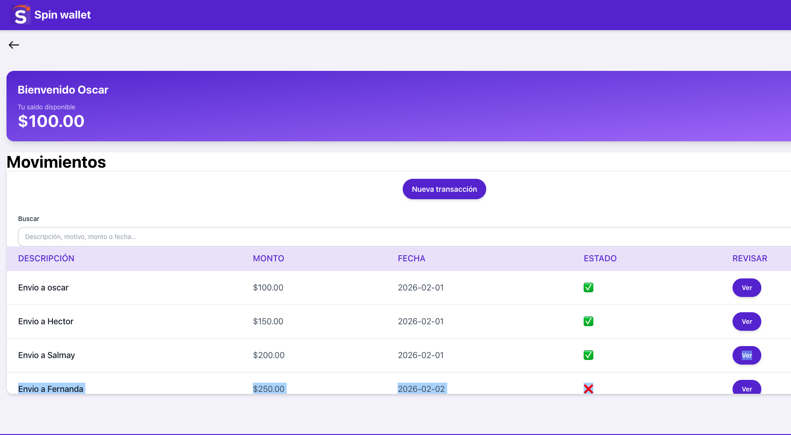

# spin-wallet

## 1. Propósito general

Mini wallet web construida con **Next.js 16 + TypeScript + Tailwind CSS 4** que simula el flujo básico de una wallet financiera:

```
Login → Home → Nueva Transacción → Confirmación / Comprobante
```



La app **no se conecta a servicios reales**: los datos provienen de **WireMock** (contenedor Docker en `:8080`), que sirve usuarios, saldo, movimientos y contactos guardados. Los Route Handlers propios (`app/api/`) actúan como proxy hacia WireMock, y dos stores en memoria del proceso del servidor (`lib/movements.ts`, `lib/contacts.ts`) simulan la persistencia de datos creados, ya que WireMock es stateless.

Funcionalidades principales:

- Login con validación de formato (email o teléfono), lookup del usuario contra el mock y sesión por cookie.
- Home con saldo disponible, nombre de usuario y lista de movimientos — por usuario (4 usuarios demo con datos propios) — con búsqueda en vivo (descripción, motivo, monto o fecha) y tabla con scroll a partir de un límite de filas visibles.
- Envío de dinero: monto (con decimales), motivo, selección de contacto favorito o alta de contacto nuevo (persistido server-side).
- Resumen de confirmación antes de enviar.
- Comprobante con escenarios aleatorios: éxito, fondos insuficientes, error de red, timeout y error desconocido, con opción de reintento.
- Reglas de negocio en el servidor: monto > 0, saldo suficiente (contra el balance real) y destinatario obligatorio.
- Testing en dos capas: unitario (Vitest + Testing Library) y E2E del flujo completo (Playwright, headed con `slowMo` para demo visible).

## 2. Cómo correrlo

### Build y producción


```bash
# Todo containerizado (web + wiremock en Docker):
make up           # docker compose up -d --build → http://localhost:3000
```

### Instalación

#### Variables de entorno

Copiar el archivo `.env.example` a `.env`, en caso de usar `make up` no es necesario configurar las variables de entorno.

| Variable | Requerida | Default | Exposición | Descripción |
|---|---|---|---|---|
| `USERS_API_BASE_URL` | No | `http://localhost:3000/api` | Servidor | Base URL de los Route Handlers propios que consumen `apiGet`/`apiPost` |
| `MOCK_API_URL` | No | `http://localhost:8080` | Servidor | Upstream al que los Route Handlers proxifican (WireMock). En docker-compose apunta a `http://wiremock:8080` |
| `API_CHAOS` | No | `true` | Servidor | `"false"` desactiva la inyección de errores aleatorios en `POST /api/user/:id/movements`. Lo usa Playwright vía `webServer` |
| `FAKE_ERROR_LOGIN` | No | `false` | Servidor | `"true"` hace que `getUsers` devuelva `[]` (→ "Usuario no registrado") y agrega 2s de latencia en `getUser` |
| `API_TIMEOUT_MS` | No | `10000` | Servidor | Timeout en ms de `apiGet`/`apiPost` contra la API propia. Bájalo (p. ej. `2000`) para ver el comprobante `408` sin esperar |
| `CHAOS_DELAY_MS` | No | `0` | Servidor | Ms que duerme cada POST de transacción cuando el caos está activo (`API_CHAOS≠false`). `0` = sin delay global; súbelo para volver lentos todos los flujos, o por encima de `API_TIMEOUT_MS` para que todos terminen en timeout |
| `LOGIN_DELAY_MS` | No | `500` | Servidor | Ms que espera `loginUser` antes de redirigir a `/home` (latencia simulada de login) |
| `CHAOS_408_DELAY_MS` | No | `3000` | Servidor | Ms extra que duerme la rama `408` del caos — se suman a `CHAOS_DELAY_MS` — para simular el hang de red |

```bash
cp .env.example .env   # variables locales (ver tabla abajo)
npm install            # solo necesario para desarrollo local (make dev)
                       # para docker (make up) el npm ci corre dentro de la imagen
make dev               # docker compose up -d wiremock + npm run dev
# o manualmente:
docker compose up -d wiremock
npm run dev       # http://localhost:3000
```

### Pruebas

```bash
npm install    
make test
```

### Pruebas e2e

```bash
docker compose up -d wiremock # levanta el mock de wiremock
npm install    
npx playwright install chromium
make e2e         # Playwright headed — recorre el flujo completo en el navegador
make e2e-ui      # Playwright UI mode (watch, time-travel, re-run)
make e2e-debug   # Playwright Inspector — pausa antes de cada acción
```

### Usuarios demo

Cualquier password ≥ 8 caracteres. Cada usuario tiene datos propios:

| Email | Teléfono | Datos |
|---|---|---|
| `oscar@gmail.com` | `5512345678` | $100, 4 movimientos |
| `hector@gmail.com` | `5523456789` | $200, 2 movimientos |
| `salmay@gmail.com` | `5534567890` | $300, 1 movimiento |
| `pepe@gmail.com` | `5545678901` | $500, 0 movimientos (estado vacío) |


## 3. Diseño de arquitectura (flujo en terminal)

```
┌──────────────────────────────────────────────────────────┐
│                    CLIENT / BROWSER                      │
│   Formularios / Modales / useActionState / Estado local  │
└──────────────────────────┬───────────────────────────────┘
                           │
                           ▼
┌──────────────────────────────────────────────────────────┐
│                      NEXT.JS APP                         │
│                                                          │
│  ┌────────────────────────────────────────────────────┐  │
│  │ ROUTING + GUARD                                    │  │
│  │ App Router / proxy.ts (cookie userId)              │  │
│  └───────────────────────┬────────────────────────────┘  │
│                          │                               │
│                          ▼                               │
│  ┌────────────────────────────────────────────────────┐  │
│  │ PRESENTATION                                       │  │
│  │ Pages (server) / Suspense / Server Components       │  │
│  │ Client Components: login, transactions, modales    │  │
│  └───────────────────────┬────────────────────────────┘  │
│                          │                               │
│                          ▼                               │
│  ┌────────────────────────────────────────────────────┐  │
│  │ APPLICATION / BUSINESS RULES                        │  │
│  │ Server Actions: loginUser, sendTransaction,         │  │
│  │ getSavedContacts, logout                            │  │
│  │ Validaciones: formato, monto, saldo, destinatario  │  │
│  └───────────────────────┬────────────────────────────┘  │
│                          │                               │
│                          ▼                               │
│  ┌────────────────────────────────────────────────────┐  │
│  │ ROUTE HANDLERS (app/api/) — API propia             │  │
│  │ Proxy a WireMock + inyección de caos en POST       │  │
│  │ /user/{id}/movements                               │  │
│  └───────────────────────┬────────────────────────────┘  │
│                          │                               │
│                          ▼                               │
│  ┌────────────────────────────────────────────────────┐  │
│  │ DATA ACCESS                                        │  │
│  │ lib/api.ts (fetch) / lib/mock-api.ts (proxy)       │  │
│  │ lib/movements.ts + lib/contacts.ts (stores)        │  │
│  │ lib/session.ts (cookies) / "use cache" + updateTag │  │
│  └───────────────────────┬────────────────────────────┘  │
└──────────────────────────┼───────────────────────────────┘
                           │
                           ▼
┌──────────────────────────────────────────────────────────┐
│                    EXTERNAL SYSTEMS                      │
│      WireMock (Docker :8080) — API mockeada              │
│      GET /users · GET /user/{id} · GET /saved-contacts   │
│      GET|POST /user/{id}/movements                       │
└──────────────────────────────────────────────────────────┘
```

### 3.1 Flujo de renderizado

La app usa **App Router con una mezcla deliberada de Server y Client Components** (SSR + CSR):

- **Server Components** (default): `app/layout.tsx`, `app/home/page.tsx`, `userData`, `movements`, `tableMovements`, `DetailTable`, `Header`, página de confirmación y detalle de transacción. Hacen fetch server-side sin waterfalls en el cliente.
- **Client Components** (`"use client"`): `login/page.tsx`, `transactions/page.tsx`, `modalContact`, `modalConfirmTransaction`, `actionTransaction`, `alert`, `backButton`, `button`, `input`. Son las "islas" interactivas al final del árbol.
- **Suspense + streaming**: `home/page.tsx` envuelve `UserData` y `Movements` en `<Suspense>` para renderizar el shell al instante mientras los datos cargan.
- **`"use cache"`**: `getUser(id)` y `getMovements(id)` cachean las respuestas con `cacheLife("minutes")` y `cacheTag("user")`; `sendTransaction` invalida ambos con `updateTag("user")` tras cada intento de transacción (read-your-own-writes).
- **`export const instant = false`**: las páginas que dependen por completo de `params`/`searchParams` (`transactions/[id]`, `confirmation/[status]/[id]`) optan por render bloqueante en lugar de shell con Suspense.

```
Browser → proxy.ts (guard por cookie) → Layout (Header/Footer)
  → Page
    ├── Server Components → lib/users.ts → Route Handlers → WireMock
    │     ("use cache" + cacheTag por función)
    └── Client Components → useActionState → Server Actions
          → validaciones → apiPost → addMovement → redirect / {error}
  → HTML + RSC payload → Hydration → UI interactiva
```

### 3.2 Flujo de navegación y routing

`proxy.ts` actúa como guard de sesión: sin cookie `userId` redirige a `/login`; con cookie y estando en `/` o `/login` redirige a `/home`. Las rutas `/api/*` están excluidas del matcher.

```
/                                    Landing pública → link a /login
/login                               Formulario de login (client)
/home                                Saldo + movimientos (server, protegida)
/transactions                        Nueva transacción (client, protegida)
/transactions/[id]                   Detalle de un movimiento (server)
/transactions/confirmation/[status]/[id]   Comprobante; status y datos por URL
/api/users                           GET → proxy /users
/api/user/[id]                       GET → proxy /user/{id}
/api/user/[id]/movements             GET → proxy · POST → caos + proxy
/api/saved-contacts                  GET → proxy /saved-contacts
```

- **Rutas dinámicas**: `[id]` en detalle; `[status]` + `[id]` anidados en confirmación.
- **Datos del comprobante por query string**: `?cantidad=&motivo=&contacto=` leídos vía `searchParams` (limitación conocida).
- **Navegación**: `Link` en tabla de movimientos, landing y header; `router.push`/`router.back()` en botones client; `redirect()` dentro de Server Actions.
- **`app/loading.tsx`**, **`app/not-found.tsx`** y **`app/home/error.tsx`** presentes; el resto de rutas no tiene `error.tsx` propio.

### 3.3 Flujo de consumo de APIs y datos

Arquitectura de dos capas HTTP, todo server-side:

```
Server Component / Action
   → lib/api.ts        (cliente HTTP simple: apiGet / apiPost, sin lógica)
     → app/api/*       (Route Handlers propios — la "API mockeada")
       → lib/mock-api.ts (proxyToMock: reenvía request/response, 502 si cae)
         → WireMock :8080
```

**Route Handlers** (`app/api/`): proxifican a WireMock vía `proxyToMock`. El `POST /user/{id}/movements` además inyecta **caos por request**: con el caos activo, cada POST espera `CHAOS_DELAY_MS` (default 0, sin delay global) y luego sortea: 25% proxifica real a WireMock, 15% `500`, 20% `400` (fondos insuficientes), 20% `408` (Timeout de red — espera `CHAOS_408_DELAY_MS` extra, default 3s, para simular el hang), 20% `520`. Es el motor de los escenarios aleatorios del comprobante. El kill-switch `API_CHAOS=false` lo desactiva (lo usan los tests E2E para un happy path determinista). El caos vive en la capa de API — `apiPost` es transporte puro que cualquier consumidor puede usar sin heredar fallos aleatorios.

Ambas capas HTTP usan `AbortSignal.timeout`: `API_TIMEOUT_MS` (default 10s) en `apiGet`/`apiPost` y 5s en `proxyToMock`; el caos duerme `CHAOS_DELAY_MS` (default 0) en cada POST cuando está activo. Si WireMock no contesta a tiempo, el proxy responde `504`; si el timeout ocurre en `sendTransaction`, el comprobante muestra `408` (Timeout de red) en vez de `520`.

**Server Actions** (`"use server"`):

| Action | Archivo | Rol |
|---|---|---|
| `loginUser` | `app/login/actions.ts` | Valida formato y contraseña → lookup del usuario en `getUsers()` (email o teléfono) → cookie `userId` con su id → delay de `LOGIN_DELAY_MS` (default 0.5s) → redirect a `/home` |
| `sendTransaction` | `app/transactions/actions.ts` | Valida monto/motivo/contacto/saldo → `apiPost` → `addMovement` (completed/failed) → `updateTag` → redirect a confirmación con un `transactionId` generado server-side (`Date.now()`, mismo patrón que los contactos) |
| `getSavedContacts` | `app/transactions/actions.ts` | GET `/saved-contacts` fusionado con contactos creados |
| `logout` | `app/login/actions.ts` | Borra sesión, redirect a `/` |

**Persistencia mockeada** (en memoria del proceso Node, keyed por userId donde aplica):

- `lib/movements.ts` — `Map<userId, Movement[]>`: `sendTransaction` registra cada intento (`status: "completed" | "failed"`). `getMovements` los antepone a los stubs de WireMock; `getUser` descuenta del saldo solo los `completed` (con `roundMoney` contra errores de punto flotante).
- `lib/contacts.ts` — `SavedContact[]`: contactos creados en la demo, fusionados en `getSavedContacts`.

**Datos por usuario**: WireMock tiene stubs con `urlPath` exacto + `priority: 1` para `/user/2|3|4` y `movement-list-2|3|4` (el patrón `/user/[0-9]+` queda como fallback del id 1). Cada login muestra datos distintos; `pepe@gmail.com` tiene 0 movimientos — hace demostrable el estado vacío.

**Flags de demo**: `FAKE_ERROR_LOGIN=true` hace que `getUsers` devuelva `[]` (→ "Usuario no registrado") y agrega 2s de latencia en `getUser` — simula error/carga en login.

Las llamadas son **100% server-side**; ninguna URL ni respuesta de WireMock llega al navegador.

### 3.4 Procesos en segundo plano

No hay polling, WebSockets, timers ni cron jobs. Lo más cercano: el delay global `CHAOS_DELAY_MS` del caos en cada POST, los `CHAOS_408_DELAY_MS` extra de la rama `408` (simulan el hang del timeout) y `LOGIN_DELAY_MS` en `loginUser` / 2s en `getUser` con `FAKE_ERROR_LOGIN=true` (simulan latencia).

### 3.5 Árbol de módulos

```
app/
├── layout.tsx                    # Layout raíz: Header + BackButton + Footer
├── page.tsx                      # Landing → link a /login
├── loading.tsx / not-found.tsx   # Estados de ruta
├── globals.css                   # Tailwind 4 + @theme (colores custom)
├── api/                          # Route Handlers — API mockeada propia
│   ├── users/route.ts            # GET → proxy /users
│   ├── user/[id]/route.ts        # GET → proxy /user/{id}
│   ├── user/[id]/movements/      # GET → proxy · POST → caos + proxy
│   └── saved-contacts/route.ts   # GET → proxy /saved-contacts
├── login/
│   ├── page.tsx                  # Formulario (client) + useActionState
│   └── actions.ts                # loginUser / logout (server actions)
├── home/
│   ├── page.tsx                  # Suspense: UserData + Movements (server)
│   └── error.tsx                 # Error boundary del segmento (client)
├── transactions/
│   ├── page.tsx                  # Formulario de envío (client)
│   ├── actions.ts                # sendTransaction / getSavedContacts
│   ├── [id]/page.tsx             # Detalle de movimiento (server)
│   └── confirmation/[status]/[id]/
│       ├── page.tsx              # Comprobante (server, params+searchParams)
│       └── actionTransaction.tsx # Reintentar (form action) + Regresar (client)
components/
├── header.tsx / footer.tsx / alert.tsx
├── contacts/modalContact.tsx     # Alta de contacto (client, onSave prop)
├── home/                         # userData / movements / tableMovements
├── transactions/                 # modalConfirmTransaction, contactSelect, useContacts
└── general/                      # button, input, title, detailTable, backButton…
lib/
├── api.ts                        # Cliente HTTP base (apiGet/apiPost, sin lógica)
├── api-paths.ts                  # USERS_PATH / userPath / userMovementsPath — paths compartidos
├── mock-api.ts                   # proxyToMock — boundary hacia WireMock
├── users.ts                      # getUser / getMovements ("use cache") / getUsers
├── movements.ts                  # Store de movimientos creados (por usuario)
├── contacts.ts                   # Store de contactos creados
├── session.ts                    # getSession / setSession / clearSession
└── format.ts                     # roundMoney / formatCurrency (MXN)
types/types.ts                    # AlertProps, User, Movement, SavedContact
wiremock/mappings/                # Stubs: users, user, user-{2,3,4},
                                  #   movement-list{-2,-3,-4}, movement-create,
                                  #   saved-contacts
proxy.ts                          # Guard de rutas por cookie
tests/wallet-flow.spec.ts         # Playwright E2E del flujo completo
**/*.test.ts(x)                   # Suites Vitest colocalizadas (63 tests)
vitest.config.ts / vitest.setup.ts
playwright.config.ts              # webServer: API_CHAOS=false LOGIN_DELAY_MS=0 npm run dev
Dockerfile / docker-compose.yml / Makefile
.env.example                      # Plantilla de variables (commiteada)
```

## 4. Estrategia de renderizado y rendimiento

| Estrategia | Estado |
|---|---|
| Server Components (menos JS en cliente) | ✅ Implementado — páginas de datos son server; client solo en islas interactivas |
| Suspense + Streaming | ✅ `home` envuelve `UserData` y `Movements` |
| `"use cache"` + tags | ✅ `getUser` y `getMovements` con `cacheTag("user")`, invalidados por `updateTag` en mutaciones |
| Cache Components / Partial Prefetching | ✅ Habilitados en `next.config.ts` |
| Route guard (`proxy.ts`) | ✅ Redirects antes de render |
| `next/image` | ✅ Logo en `Header`, icono en `BackButton` |
| Progressive enhancement | ✅ Formularios y confirmación usan `form action` nativo |
| Formato de moneda | ✅ `Intl.NumberFormat` es-MX/MXN + `roundMoney` contra artefactos de punto flotante |
| ISR / SSG | ❌ No aplica — todo el contenido es dinámico por sesión |
| Dynamic imports / lazy loading | ❌ No identificado — bundle pequeño, no justificado |
| Error boundaries por ruta | ⚠️ Parcial — `error.tsx` en `home` (cubre fallos con Reintentar via `reset()`); el resto de rutas no tiene boundary propio |

## 5. Seguridad y manejo de información

- **Sesión**: cookie `userId` con `httpOnly`, `secure`, `sameSite: "lax"`, `maxAge` 5 min. Es mockeada (no hay autenticación real, a propósito del challenge).
- **Guard de rutas**: `proxy.ts` verifica la cookie antes de renderizar rutas protegidas; excluye `/api/*` del matcher.
- **Validación de inputs**: formato de usuario y contraseña en `loginUser`; monto > 0 (incl. `NaN`/`Infinity`), motivo, contacto y saldo contra balance real en `sendTransaction` — todas server-side, no solo en la UI.
- **Secretos**: ninguno en el código; las variables son URLs públicas del mock.
- **Acciones expuestas**: los módulos `"use server"` son endpoints RPC públicos; las validaciones viven ahí precisamente porque la UI es bypasseable.
- **Riesgos conocidos (demo)**: los datos del comprobante viajan en la URL (visibles y editables). La cookie se marca `secure` solo en producción (`NODE_ENV === "production"`); en desarrollo se omite para que el login funcione en cualquier navegador sobre `localhost` http.

## 6. Áreas de mejora

Con más tiempo, en orden de prioridad:

### Arquitectura
- Persistencia real (SQLite) en lugar de stores en memoria — los `Map` de `lib/movements.ts` y `lib/contacts.ts` viven por proceso y se pierden ante un restart o escala horizontal.
- `cacheTag` por usuario (`user:${id}`) en `getUser`/`getMovements`; hoy `updateTag("user")` invalida el cache de todos los usuarios.
- Datos del comprobante fuera de la query string: persistir el movimiento por id y leerlo server-side en la confirmación.
- Cargar los contactos server-side y pasarlos como prop, en vez del fetch client-side de `useContacts`.

### Next.js
- `error.tsx` por ruta (hoy solo `home` tiene boundary propio).

### Testing
- Tests de `lib/` (`roundMoney`, `formatCurrency`, stores).
- E2E de error paths (reintento en 408/500, fondos insuficientes) con escenario de caos determinista.

### Producto
- Autenticación real (JWT o sesión firmada) y endpoints protegidos con token.
- Idempotencia al enviar transacciones; eliminación/actualización de movimientos.
- a11y en modales (`role="dialog"`, `aria-modal`, cierre con Escape, focus trap).

## 7. Tiempo invertido

12 horas invertidas
